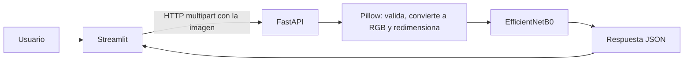

# Documento técnico de FruitVision AI

## 1. Introducción y objetivo del sistema

FruitVision AI es un sistema local de clasificación de imágenes de frutas y verduras. Su objetivo es recibir una fotografía seleccionada por la persona usuaria, enviarla al modelo EfficientNetB0 ya entrenado y presentar la categoría, el estado del producto y la puntuación asociada a esa predicción.

El alcance de este documento es la aplicación de inferencia y su verificación. El modelo, el notebook y los resultados del entrenamiento se tratan como artefactos existentes; el sistema no reentrena ni modifica esos recursos.

## 2. Requisitos funcionales y alcance

El sistema permite:

- Seleccionar una imagen admitida y ver una vista previa.
- Enviar sus bytes desde la interfaz al backend mediante HTTP.
- Validar y preparar la imagen para que coincida con la entrada esperada por el modelo.
- Consultar el estado del servicio y la información de las categorías.
- Ejecutar una inferencia y mostrar la respuesta de esa solicitud.
- Presentar errores de archivo, conexión, disponibilidad del modelo o inferencia sin sustituirlos por una predicción almacenada.

El backend carga el modelo una vez durante su inicio y lee las categorías de `models/class_names.json`. La aplicación usa los artefactos de `models/` como entradas existentes de solo lectura.

## 3. Arquitectura general

La solución separa la interfaz, el transporte HTTP, el procesamiento de imágenes y la inferencia:

1. **Frontend:** Streamlit permite seleccionar una imagen, muestra su vista previa, el progreso y el resultado.
2. **Cliente HTTP:** Requests envía los bytes al endpoint de inferencia.
3. **API:** FastAPI recibe la carga multipart y ofrece los endpoints de estado, información y predicción.
4. **Procesamiento:** Pillow valida el formato, convierte a RGB y redimensiona la imagen.
5. **Servicio de modelo:** TensorFlow/Keras carga el modelo original y calcula la predicción.
6. **Respuesta:** FastAPI devuelve categoría, estado y puntuación como JSON; Streamlit los presenta.

## 4. Diagrama de arquitectura



## 5. Tecnologías utilizadas y justificación

| Tecnología | Versión verificada o fijada | Responsabilidad y justificación |
|---|---:|---|
| Python | 3.12.2 verificado | Ejecuta backend, cliente e interfaz con un mismo ecosistema. |
| TensorFlow | 2.19.1 | Carga el modelo exportado y ejecuta inferencia. |
| Keras | 3.15.1 | Interfaz de carga del archivo `.keras` y ejecución del modelo. |
| FastAPI | 0.165.0 fijada | Define los endpoints HTTP y recibe archivos multipart. |
| Uvicorn | 0.54.0 fijada | Ejecuta la aplicación ASGI de FastAPI. |
| Streamlit | 1.66.1 fijada | Implementa la interfaz de carga, vista previa y resultados en Python. |
| Pillow | 11.2.1 fijada | Decodifica los formatos admitidos, convierte a RGB y redimensiona. |
| Requests | 2.34.2 fijada | Envía la imagen desde el frontend al servicio HTTP. |
| pytest | 9.2.0 fijada | Ejecuta las pruebas unitarias, de API, frontend e integración. |
| HTTPX | 0.28.1 fijada | Permite probar la API ASGI mediante el cliente de pruebas utilizado. |
| NumPy | 2.1.3 fijada | Representa la imagen preparada como tensor numérico. |

Las versiones fijadas se declaran en `requirements.txt`. La elección de FastAPI y Uvicorn separa la API del proceso de interfaz y facilita comprobar sus endpoints. Streamlit permite construir el flujo de usuario sin añadir una aplicación JavaScript separada. Pillow cubre las operaciones de imagen requeridas; no se necesitan transformaciones adicionales de visión por computador que justifiquen OpenCV. TensorFlow/Keras carga directamente el artefacto existente, sin convertirlo.

## 6. Descripción del modelo EfficientNetB0

El modelo utilizado es EfficientNetB0 y produce puntuaciones para 20 categorías. La aplicación carga el artefacto `models/fruitvision_ai_model.keras` con TensorFlow/Keras y obtiene nombres y orden de categorías de `models/class_names.json`. Durante el inicio comprueba que el número de salidas del modelo coincida con el número de etiquetas.

Las etiquetas se organizan en categorías Fresh y Rotten para diez productos: Apple, Banana, Bellpepper, Carrot, Cucumber, Mango, Orange, Potato, Strawberry y Tomato. El estado mostrado se deriva del prefijo de la categoría devuelta.

El SHA-256 de `models/fruitvision_ai_model.keras` es `3DCAA1D4E95AE2D5EEF6FD17180BBD4A1C92506E591651AD19A0ED5D90E8E8F1`. El artefacto de entrenamiento `models/training/fruitvision_ai_model.keras` tiene el mismo hash; la configuracion predeterminada del backend carga el modelo de produccion de `models/`. El SHA-256 registrado de `models/class_names.json` es `91974A4A50C4F0C4E86CCBC6B5AA2444AB33ADBC2B30786374BCB7D2DC75414D`.

## 7. Evidencia del entrenamiento y evaluación

El resumen de evaluación existente se encuentra en `reports/metrics.json`. Las métricas de la sección siguiente se transcriben de ese archivo y corresponden a 1765 imágenes de prueba. No son una medición de la confianza de una predicción individual.

El notebook existente está en `notebooks/fruitvision_ai_entrenamiento.ipynb`. La evidencia de preprocesamiento se obtuvo mediante consulta de solo lectura del notebook y del modelo; no se ejecutaron celdas. El SHA-256 registrado antes y después de la consulta es `08A5BB9D2F8491FD5C9395BB3AEA5A2F3AAFF2C46AF4C721E1B2D47F0466ED12`.

## 8. Métricas verificadas

| Métrica | Resultado |
|---|---:|
| Arquitectura | EfficientNetB0 |
| Número de clases | 20 |
| Imágenes de prueba | 1.765 |
| Accuracy | 96.7705 % |
| Loss | 0.0942 |
| Precision macro | 96.6790 % |
| Recall macro | 96.6602 % |
| F1 macro | 96.6479 % |
| Precision weighted | 96.8057 % |
| Recall weighted | 96.7705 % |
| F1 weighted | 96.7668 % |
| Predicciones incorrectas | 57 |

**Fuente:** `reports/metrics.json`. Los porcentajes reproducen los valores proporcionados para esta entrega; `loss` se presenta como valor decimal.

## 9. Preprocesamiento de imágenes

La entrada compatible con el modelo tiene tamaño **224 × 224**, tres canales RGB y tipo `float32`. El backend acepta JPEG, PNG y WEBP; Pillow decodifica la imagen, la convierte a RGB y la redimensiona a ese tamaño. La matriz se entrega en rango 0–255 como `float32`.

El modelo incorpora internamente las capas `Rescaling` y `Normalization`. Por tanto, la aplicación no divide los píxeles entre 255 ni aplica otra normalización externa o `preprocess_input`. Así se evita duplicar el preprocesamiento que ya forma parte del modelo.

Esta descripción coincide con la evidencia conservada en el notebook y con la entrada del modelo. El archivo `docs/artifact-integrity.md` registra las huellas SHA-256 de los artefactos verificados.

## 10. Integración entre frontend, API y modelo

Los archivos principales y sus responsabilidades son:

| Archivo | Responsabilidad |
|---|---|
| `src/frontend/app.py` | Carga, validación previa, vista previa, progreso, errores y presentación. |
| `src/frontend/client.py` | Envío HTTP de los bytes de imagen y recepción de la respuesta JSON. |
| `src/backend/api.py` | Inicio del servicio y endpoints HTTP. |
| `src/backend/config.py` | Rutas del modelo y etiquetas, límite de carga y valores predeterminados. |
| `src/backend/image_processing.py` | Validación, conversión RGB, redimensionamiento y tensor de entrada. |
| `src/backend/model_service.py` | Carga del modelo y las etiquetas; ejecución de la inferencia y formato de la respuesta. |

El modelo se carga al iniciar el backend. Si no puede cargarse, `/health` informa que no está disponible y las rutas que requieren inferencia no presentan una predicción de reemplazo.

## 11. Descripción de endpoints

| Método y ruta | Entrada | Respuesta o comportamiento |
|---|---|---|
| `GET /health` | Ninguna | Indica `ready` o `unavailable` y el campo booleano `available`. |
| `GET /model/info` | Ninguna | Devuelve el nombre `EfficientNetB0` y las categorías en el orden cargado. |
| `POST /predict` | Archivo multipart en el campo `image` | Devuelve `category`, `state` (`Fresh` o `Rotten`) y `confidence` como porcentaje. |

El límite predeterminado es 10 MiB (10.485.760 bytes). Se admiten JPEG, PNG y WEBP. El servicio responde con:

- **400:** archivo vacío, corrupto o de formato no admitido.
- **413:** archivo superior al límite configurado.
- **503:** modelo no disponible.
- **500:** error durante el procesamiento o la inferencia.

Cuando el modelo no está listo, `/health` informa disponibilidad falsa; `/model/info` y `/predict` responden con 503.

## 12. Instalación y ejecución

Los comandos se ejecutan en PowerShell desde la raíz del proyecto. Se usa el entorno virtual existente en `.venv`; si aún no existe, créalo primero. La instalación se realiza con las versiones declaradas en `requirements.txt`.

```powershell
py -3.12 -m venv .venv
.\.venv\Scripts\python.exe -m pip install --upgrade pip
.\.venv\Scripts\python.exe -m pip install -r .\requirements.txt
```

Inicia el backend en una terminal:

```powershell
.\.venv\Scripts\python.exe -m uvicorn src.backend.api:app --host 127.0.0.1 --port 8000
```

Inicia el frontend en una segunda terminal:

```powershell
.\.venv\Scripts\python.exe -m streamlit run src/frontend/app.py
```

Por defecto, Streamlit publica la interfaz en el puerto 8501 y FastAPI escucha en `http://127.0.0.1:8000`. La documentación interactiva de FastAPI está en `http://127.0.0.1:8000/docs`.

Las variables de entorno disponibles son:

| Variable | Valor predeterminado | Uso |
|---|---|---|
| `FRUITVISION_MODEL_PATH` | `models/fruitvision_ai_model.keras` | Sobrescribe la ruta del modelo. |
| `FRUITVISION_CLASS_NAMES_PATH` | `models/class_names.json` | Sobrescribe la ruta de las etiquetas. |
| `FRUITVISION_MAX_UPLOAD_BYTES` | `10485760` | Configura el máximo de bytes por archivo. |
| `FRUITVISION_API_URL` | `http://127.0.0.1:8000` | Cambia la URL base usada por el frontend. |

## 13. Pruebas unitarias y de integración

Las pruebas se encuentran en `tests/`:

- `test_image_processing.py`: formatos, RGB, tamaño, tipo de dato, rango y archivos inválidos.
- `test_model_service.py`: selección de categoría, estado y puntuación con un doble de modelo.
- `test_api.py`: estado, información, predicción y errores HTTP con un doble aislado.
- `test_frontend.py`: envío de bytes, representación de respuesta y manejo de errores de UI con respuestas controladas.
- `test_integration_model.py`: carga y uso del modelo original sin mocks, mediante una solicitud de predicción para una imagen sintética creada en memoria.

Para ejecutar toda la suite:

```powershell
.\.venv\Scripts\python.exe -m pytest -q
```

Para ejecutar únicamente la integración con el modelo real:

```powershell
.\.venv\Scripts\python.exe -m pytest tests/test_integration_model.py -q
```

## 14. Resultados de verificación

La ejecución completa registrada el **19 de noviembre de 2026** finalizó con **20 pruebas aprobadas**, **0 fallidas** y **1 advertencia** en **8.65 segundos**. La advertencia de Starlette indica que el uso de HTTPX con `starlette.testclient` está obsoleto y recomienda `httpx2`; no impidió la ejecución ni causó fallos.

En la verificación funcional registrada, la API informó estado disponible, `/model/info` devolvió 20 categorías, Streamlit sirvió la interfaz y el cliente recibió una predicción del modelo real. El [inventario de integridad](artifact-integrity.md) conserva hashes de los modelos, las etiquetas, el notebook y los artefactos locales de entrenamiento y evaluación.

## 15. Limitaciones conocidas

El clasificador está diseñado para las 20 categorías definidas en `models/class_names.json`. No tiene una clase adicional para objetos ajenos a ellas ni un mecanismo de detección de imágenes fuera de distribución (OOD). En consecuencia, una fotografía que no corresponda a una fruta o verdura de esas categorías puede recibir igualmente la predicción de una de las 20 clases.

La confianza mostrada es el score del modelo para una imagen individual. No garantiza certeza y no representa una métrica global de rendimiento. Las métricas de evaluación de este informe describen el conjunto de prueba registrado, no el resultado esperado para cualquier fotografía.

## 16. Conclusiones

FruitVision AI integra una interfaz de carga, una API HTTP y el modelo EfficientNetB0 existente en un flujo de inferencia local. El preprocesamiento documentado conserva el tamaño, los canales, el tipo de dato y el rango verificados, dejando las capas internas de normalización a cargo del modelo.

La evaluación existente alcanzó los valores detallados en `reports/metrics.json`, y la suite de verificación registrada aprobó sus 20 pruebas. El uso del sistema debe considerar el límite de sus 20 clases y la interpretación acotada de la puntuación individual.
